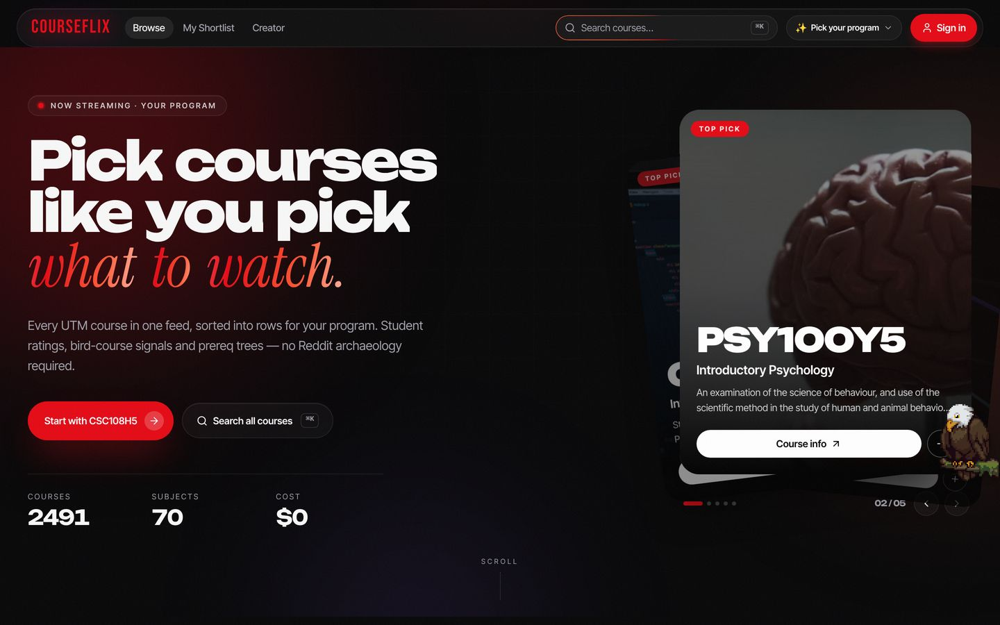
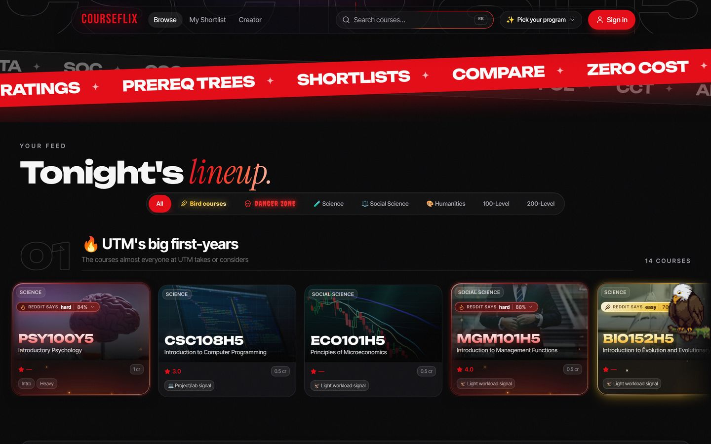
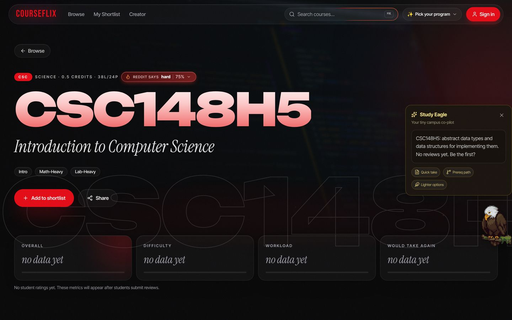
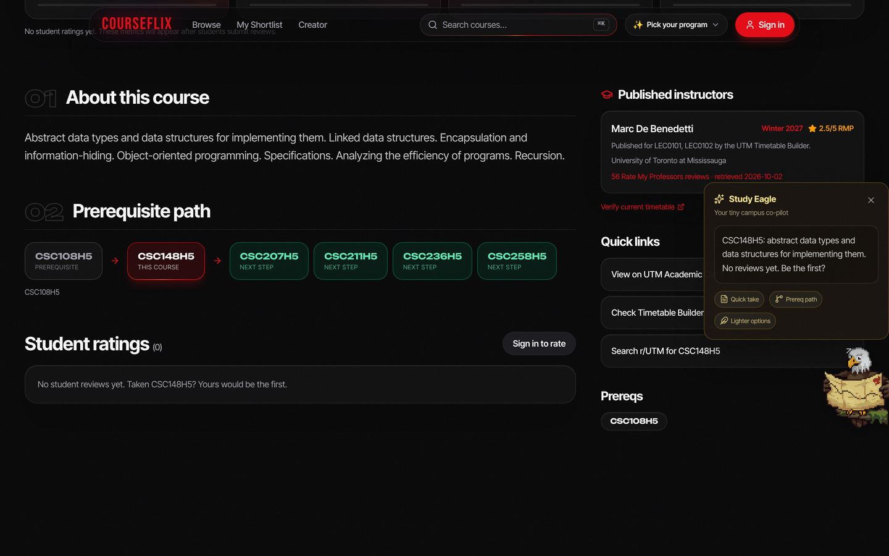
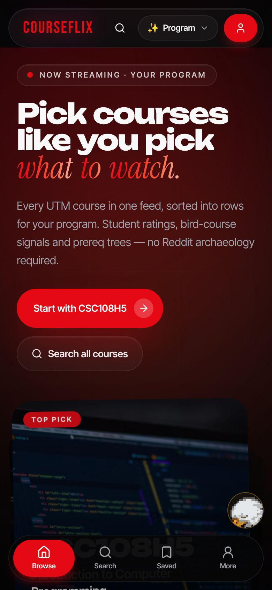
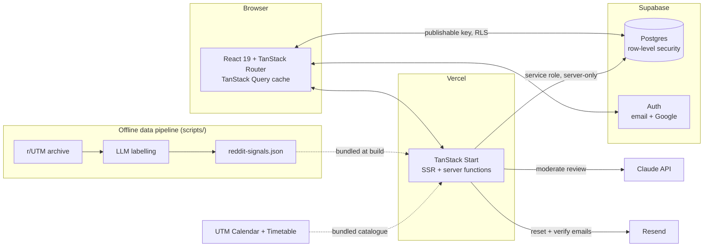

# CourseFlix

**Browse every University of Toronto Mississauga course like you browse Netflix.**

[](https://github.com/aboodgitawaida/courseflix-utm/actions/workflows/ci.yml)
**Live:** [courseflix.ca](https://www.courseflix.ca) · **Status:** beta-tested with 10 students, public launch December 2026



- **The problem:** picking courses at UTM means juggling the Academic Calendar, the Timetable Builder, Rate My Professors and r/UTM.
- **The product:** one page per course and a home feed rebuilt around your program, covering **2,491 courses** and **44 programs**.
- **The stack:** TypeScript, React 19, TanStack Start (SSR), Supabase Postgres with row-level security, Vercel, and the Claude API.

## Screenshots

| Program-aware feed                                                                                                     | Course page                                                                            |
| ---------------------------------------------------------------------------------------------------------------------- | -------------------------------------------------------------------------------------- |
|                         |  |
| **Prerequisites, instructors and the Study Eagle**                                                                     | **Phone**                                                                              |
|  |         |

## Features

- **A home feed for your program.** Pick one of 44 UTM programs and the feed rebuilds into rows: core courses, first- and second-year picks, upper-year seminars, lighter-workload options, and the courses that unlock the most others.
- **A page for every course.** Official description, a "what this unlocks" prerequisite path, this term's instructors with Rate My Professors ratings, and links to the calendar, timetable and Reddit. Each page is server-rendered with its own SEO metadata.
- **Bird courses and the danger zone.** Courses that r/UTM mostly calls easy glow gold; the ones it calls hard glow red. These are built from thousands of real Reddit comments (see [How the AI is used](#how-the-ai-is-used)).
- **Student reviews.** Rate difficulty, workload and "would take again". Reviews are anonymous to the public, posting needs a confirmed email, and an AI check blocks threats, hate and doxxing without censoring honest criticism.
- **Shortlist, compare and share.** Save courses, compare them side by side, share a list as a link, or export it as an Instagram-story image.
- **Friends.** Add classmates, see each other's shortlists (unless private) and get notified when a friend saves a course.
- **The little things.** A ⌘K command palette, achievements, light and dark themes, installable as a phone app, and the Study Eagle: an animated pixel-art companion who reacts to what you do on the site.

## How the recommendations work

The home feed is **deterministic, not AI-generated**, so it is fast, explainable and free to run. [`getRailsForMajor`](src/lib/courses.ts) builds each row from:

1. **Program requirements.** Each of the 44 programs lists its core and supporting subjects ([`majors.ts`](src/lib/majors.ts)).
2. **Year level.** It separates first- and second-year starting points from upper-year picks and 400-level seminars.
3. **The prerequisite graph.** It ranks "gateway" courses by how many later courses they unlock.
4. **Workload and difficulty signals** from student reviews and Reddit.

Without a program, the feed ranks the courses that unlock the most and mixes subjects, so it isn't alphabetical. If a visitor keeps browsing one subject, the site offers that program with one tap ([`interest.ts`](src/lib/interest.ts)). That tracking is stored only in the browser.

## How the AI is used

| Where                                                                                              | What it does                                                                                                                                         | Model                                        |
| -------------------------------------------------------------------------------------------------- | ---------------------------------------------------------------------------------------------------------------------------------------------------- | -------------------------------------------- |
| **Review moderation** (live, [`review-moderation.server.ts`](src/lib/review-moderation.server.ts)) | Screens each new review against a deliberately lenient policy. Harsh opinions are allowed; threats, hate, private info, harassment and spam are not. | Claude, with JSON-schema structured output   |
| **Reddit signals** (offline, [`scripts/`](scripts))                                                | Labels thousands of r/UTM and r/UofT comments by how they describe a course's difficulty and workload. These labels produce the gold and red tiers.  | Claude Haiku, Gemini or a local Ollama model |

Design choices:

- **Moderation fails open.** If the API is down or not configured, the review publishes and the "Report review" link is the safety net. A third-party outage never blocks students.
- **Prompt-injection hardening.** The review text is passed inside `<review>` tags, and the model is told to treat it as data, not instructions.
- **Server-only keys.** The SDK is imported dynamically on the server, so neither it nor the key ever reaches the browser bundle.
- **Thresholds against noise.** A course only turns gold or red with at least 10 opinions and a 70% majority ([`reddit-signals.ts`](src/lib/reddit-signals.ts)).
- **Human spot-checks.** A spot-check page samples labelled comments for checking by hand and tracks the AI's accuracy.

## Architecture



- **Static data ships with the app.** The course catalogue, instructors and Reddit signals are bundled at build time. Browsing courses needs no database round-trip, and the big descriptions file is code-split and lazy-loaded.
- **Supabase holds only user data.** That means reviews, shortlists, friendships, notifications and achievements, with row-level security on every table.
- **Privileged work runs in server functions.** Posting reviews, sending password resets and verification emails use the service-role key, which never leaves the server.

## Engineering highlights

- **Privacy by design.** Reviews are read through a view that drops the author's ID, so they are public without being traceable, while each user can still edit and delete their own.
- **Abuse limits in Postgres.** Friend requests, password resets and verification emails are rate-limited with database-backed counters, so the limits hold across serverless instances.
- **Defence in depth.** Review verification is enforced in both the server function and the database policies. Security headers (CSP, HSTS, frame denial) are set in [`vercel.json`](vercel.json), and auth redirects only allow same-site paths.
- **Performance.** Rating stats for every visible course load in one cached request instead of about 100 per page, and course descriptions, about two-thirds of the catalogue's size, are code-split.
- **Honest data.** Ratings only ever come from real reviews or Rate My Professors, and the site says so when a course has none.
- **Safe migrations.** Migrations only add things. A written policy ([CLAUDE.md](CLAUDE.md)) forbids anything that could remove or rewrite real students' data.

## Tech stack

| Layer         | Choice                                                                                            |
| ------------- | ------------------------------------------------------------------------------------------------- |
| App           | React 19, TanStack Start (SSR), TanStack Router and Query, Tailwind CSS 4, Radix UI               |
| Data and auth | Supabase: Postgres, row-level security, email and Google sign-in                                  |
| AI            | Claude API (moderation, labelling), with Gemini or Ollama as alternatives in the offline pipeline |
| Email         | Resend                                                                                            |
| Hosting       | Vercel, with Analytics and Speed Insights                                                         |
| Quality       | TypeScript (strict), ESLint, Prettier, Vitest and Testing Library, GitHub Actions CI, Dependabot  |

## Getting started

You need Node 22+ and a free [Supabase](https://supabase.com) project.

```bash
git clone https://github.com/aboodgitawaida/courseflix-utm.git
cd courseflix-utm
npm ci
cp .env.example .env        # add your Supabase URL and publishable key
npm run hooks:install       # optional: Conventional Commits check
npm run dev                 # http://localhost:8080
```

Apply the schema in [`supabase/migrations/`](supabase/migrations) to your project (see [docs/operations.md](docs/operations.md)). Browsing works with just the two `VITE_SUPABASE_*` values. Reviews, password reset and moderation also need the server-only keys below.

### Environment variables

| Variable                                             | Needed for                                                          | Where it runs      |
| ---------------------------------------------------- | ------------------------------------------------------------------- | ------------------ |
| `VITE_SUPABASE_URL`, `VITE_SUPABASE_PUBLISHABLE_KEY` | Everything                                                          | Browser and server |
| `SUPABASE_URL`, `SUPABASE_PUBLISHABLE_KEY`           | Server-side rendering                                               | Server             |
| `SUPABASE_SERVICE_ROLE_KEY`                          | Password reset, verification emails                                 | Server only        |
| `RESEND_API_KEY`                                     | Sending those emails                                                | Server only        |
| `ANTHROPIC_API_KEY`                                  | Review moderation (optional; without it, reviews publish unchecked) | Server only        |
| `GEMINI_API_KEY`, `OLLAMA_*`, `PIXELLAB_API_KEY`     | Offline scripts only                                                | Your machine       |

[`.env.example`](.env.example) has every variable with placeholders.

### Scripts

| Command                                                         | What it does                                               |
| --------------------------------------------------------------- | ---------------------------------------------------------- |
| `npm run dev`                                                   | Dev server with hot reload                                 |
| `npm run check`                                                 | Typecheck, lint, formatting and unit tests, the same as CI |
| `npm test`                                                      | Vitest unit and component tests                            |
| `npm run build`                                                 | Production build                                           |
| `npm run sitemap`                                               | Regenerate `public/sitemap.xml` for all course pages       |
| `npm run reddit-reviews` → `reddit-classify` → `reddit-signals` | Refresh the Reddit easy/hard signals                       |

## Testing

Unit and component tests run on every pull request (Vitest, Testing Library, jsdom). They cover:

- the recommendation rows,
- input validation and the auth-redirect guard,
- review verification and moderation, and
- the Reddit signal thresholds and tiers,
- plus the notification bell and a browser smoke test of the root layout,
- and the Study Eagle's state machine.

## Project structure

```
src/
  routes/         file-based pages: home, course/$code, list, friends, settings, ...
  components/     UI: course cards and rows, hero, ⌘K palette, Study Eagle
  hooks/          shared React hooks (auth, theme, sound, Study Eagle companion)
  lib/            domain logic, server functions (*.server.ts) and the bundled catalogue
  integrations/   Supabase clients and generated database types
supabase/migrations/  schema, row-level security policies and functions
scripts/          offline data pipelines (catalogue, sitemap, Reddit signals, sprites)
assets/eagle-src/ source art and generation requests for the Study Eagle
docs/             operations guide and screenshots
```

## Roadmap

- [x] Program-aware feed, course pages, reviews, shortlists, friends, achievements
- [x] AI review moderation and Reddit-derived bird-course and danger-zone tiers
- [ ] Public launch (December 2026)
- [ ] **Course Wrapped:** a Spotify Wrapped-style recap of your shortlist (built, behind a feature flag)
- [ ] **Hardest-course bracket:** a 16-course knockout vote (built, behind a feature flag)
- [ ] Study Eagle answers questions from real review data
- [ ] End-to-end tests for sign-up, reviewing and sharing

## How it was built

I built CourseFlix with AI coding tools. It started from a Lovable scaffold, and much of the code was written with Claude Code, which is why many commits are authored by Claude. My job was deciding what the product should be and holding the work to that: I set the requirements, made the trade-offs, reviewed and tested changes on the live site, and ran the database and launch setup myself.

Some of the calls I made along the way:

- **Instant sign-up, verified reviews.** Forcing email confirmation up front made signing up feel like a chore, but dropping it entirely would let anyone post reviews under someone else's email. I chose the middle ground: anyone can browse, save and add friends instantly, and only posting a review needs a confirmed email.
- **Any email, not just UofT.** Students shouldn't need a school address to plan courses.
- **Lenient moderation.** Students should be able to say a course or professor is bad. Only threats, hate, harassment, someone's private information and spam are blocked; everything else is published, and anything that slips through can be reported.
- **Free to run.** The whole stack runs on free tiers. A scheduled job keeps the free database from pausing, and paid features (like automated moderation) are optional switches rather than requirements.

## Data sources

Course information comes from the [UTM Academic Calendar](https://utm.calendar.utoronto.ca/) and instructors from the [UTM Timetable Builder](https://ttb.utoronto.ca/). Professor ratings are from [Rate My Professors](https://www.ratemyprofessors.com/), shown with a link to each profile and the date they were retrieved. Reddit signals come from public r/UTM and r/UofT comments. CourseFlix is an independent student project, not affiliated with the University of Toronto or Netflix.

## License

Copyright (c) 2026 Abood Awaida. All rights reserved: the code is public to read, not to reuse. See [LICENSE](LICENSE).
