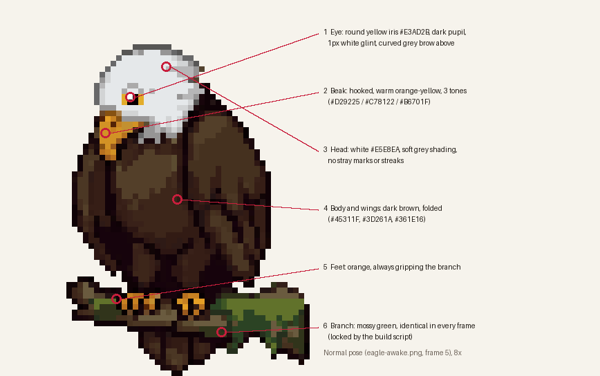

# Study Eagle: character sheet

What the eagle should always look like. Check every new animation against this
list before it goes in, and point at the numbered item when something looks off
("4 is wrong in frame 3"). `character-sheet.png` shows the numbered spots on his
normal pose.

## Look

1. **Eye.** One round eye: yellow iris `#E3AD2B`, dark pupil, a 1 px white
   glint, and a curved grey brow arching above it. Never a low, slanted brow
   (it reads as sad). The build script redraws this eye on animated frames
   (`fix_eye`). Closed or half-shut eyes only belong in sleep, the yawn
   and the one blink frame of the idle loop.
2. **Beak.** Hooked, warm orange-yellow in three tones (`#D29225`, `#C78122`,
   `#B6701F`). Same size and shape in every frame.
3. **Head.** White `#E5E8EA` with soft grey shading. No stray grey marks,
   streaks or leftover brow pixels on the white.
4. **Body and wings.** Dark brown (`#45311F`, `#3D261A`, `#361E16`), wings folded
   unless the animation is about the wings (celebrate, trophy, startled).
5. **Feet.** Orange, gripping the branch in every frame. He never leaves the
   branch, even when he jumps.
6. **Branch.** Mossy green, identical in every frame. The build script locks it
   to the normal pose, so the model can't move or redraw it.

## Pose and framing

- He faces the page. Source art faces right; the build script mirrors every
  sheet so he faces left, with the branch's cut end against the right edge.
- One frame size for every sheet: 56 x 68 art pixels, shown at 2x on desktop and
  1.5x on phones, with crisp (pixelated) scaling.
- His size doesn't change between animations. Prop animations may have him sit
  a little more upright, but his head and body stay the same size.

## Props

- One prop at a time, held in his wings like hands: book, magnifying glass,
  notepad and pencil. Never on his head.
- Props keep their own colours (the build script gives each prop sheet a few
  extra palette colours), and must be big enough to read at 2x.
- Prop animations take the prop out once, then loop only the "using it" part
  for as long as the student is doing that thing (reading a preview, searching).

## Effects

- Small floating extras are allowed only when they're the point: shock marks
  (startled), hearts (pet), confetti (celebrate), the gold trophy and its sparkles (trophy), the Z (sleep). Anything else
  floating is a speck and gets removed (`drop_specks`).

## Motion

- Loops must not jump: the last frame flows into the first.
- One-shot animations end close to the normal pose so the switch back to idle is
  invisible.
- With reduced motion on, every animation shows a single still frame.
